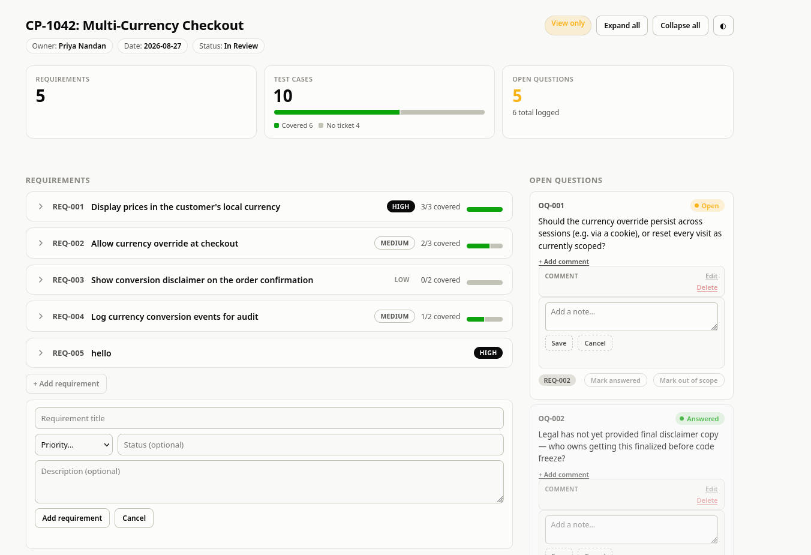

# RTM Dashboard

A requirement traceability matrix for one feature (a CP) in one plain-text
file, `requirement.md`, with an interactive dashboard on top. Python 3
stdlib only, no build step, no database.

It shows, per feature:

- **Requirements**, each with its **test cases**
- **Coverage by ticket**: a test case is covered once it has a ticket number
- **Open questions** the requirements don't answer yet

## Requirements

- **Claude Code CLI**, started from this folder (`claude`). `/rtm-import`
  and `/rtm-jira-ac` are Claude Code skills, and publishing the shared
  Artifact also goes through it. Without it you can still run the local
  dashboard and edit `requirement.md` by hand, but not import or push to Jira.
- **Python 3** (stdlib only) for the local dashboard server.
- For `/rtm-jira-ac` only: **Node.js** and the **Atlassian connector**
  enabled in Claude Code.

## For a PO: end to end

Worked example, using the feature `multi-currency-checkout`. Start Claude
Code in this folder. The `/…` commands run inside it; the `python3 …`
command runs in a normal terminal.

**1. Turn your doc into a tracked feature**

```
/rtm-import multi-currency-checkout ~/docs/CP-1042-prd.md
```

This creates `features/multi-currency-checkout/` with the requirements, test
cases and open questions taken from your doc, plus a shared Claude Artifact
titled "Multi-Currency Checkout". It lists anything it couldn't place.
Ticket numbers are never invented, and priorities stay blank unless your doc
signals them.

**2. Open the dashboard**

```
python3 serve.py features/multi-currency-checkout
```

Open <http://localhost:8000/RTMdashboard.html>. To share instead, send the
Artifact link from `features/multi-currency-checkout/ARTIFACT.md`.

**3. Work it.** The page opens **Read-only**; flip the switch to **Edit**.

| You want to | Do this |
|---|---|
| Mark a test case as covered | Type its ticket number (`PAY-2201`) and press Enter |
| Resolve a question | **Mark answered** on the open question |
| Defer something without deleting it | **Mark out of scope** (dimmed, left out of the stats) |
| Leave a note for the team | **Add comment** on a requirement, test case or question |
| Add something missing | **+ Add requirement / test case / open question** |

**4. Copy test cases into Jira (optional)**

```
/rtm-jira-ac multi-currency-checkout
```

Drafts acceptance criteria and a Required Tests block for each ticket and
shows them to you. It writes to Jira only after you approve.

**5. The PRD changed?** Re-run step 1 with the updated doc. It merges
rather than overwrites: tickets, answered questions, out-of-scope marks and
comments are kept.

## Files

```
REQ-Traceability-Dashboard/
├── serve.py        # local server: serves a feature folder, saves edits into requirement.md
├── format.md       # the requirement.md format spec + blank starter
├── .claude/skills/
│   ├── rtm-import/    # /rtm-import: doc -> requirement.md + dashboard + Artifact
│   └── rtm-jira-ac/   # /rtm-jira-ac: test cases -> Jira acceptance criteria
└── features/<name>/
    ├── requirement.md              # the data (hand-editable)
    ├── RTMdashboard.html           # local dashboard
    ├── RTMdashboard-artifact.html  # source of the shared Artifact
    └── ARTIFACT.md                 # the Artifact's live link
```

## Local dashboard vs shared Artifact

- **Local** (`RTMdashboard.html` + `serve.py`): one user, every edit is
  written into `requirement.md`. A plain `python3 -m http.server` can view
  but not save.
- **Shared Artifact**: a copy published on claude.ai, no server needed.
  Several people can edit; people without edit access get a view-only page.
  It is a snapshot, not live-synced with `requirement.md`. `/rtm-import`
  reconciles the two in both directions.

## `requirement.md` format

Full spec, including out-of-scope and comments, is in `format.md`.

```
# CP-1042: Multi-Currency Checkout
> Owner: Priya Nandan | Date: 2026-08-27 | Status: In Review

### REQ-001: Display prices in the customer's local currency
> Priority: High | Status: Approved

The checkout page must show all prices in the customer's local currency.

#### Test Cases
- TC-001: Supported locale shows converted prices — Ticket: PAY-2201
  Given locale de-DE. When the checkout loads. Then all prices show in EUR.

## Open Questions
- OQ-001 (Related: REQ-001): How stale can the daily rate be? — Status: Open
```

Write a test case description as `Given … When … Then …` and the dashboard
shows each part on its own line.

## Limits

- Single-user and local: no locking, so two `serve.py` instances on the same
  file can overwrite each other.
- No auth. Use `serve.py` on `localhost` only.
- The parser follows the format above; it is not a general markdown parser.

- sample dashboard
